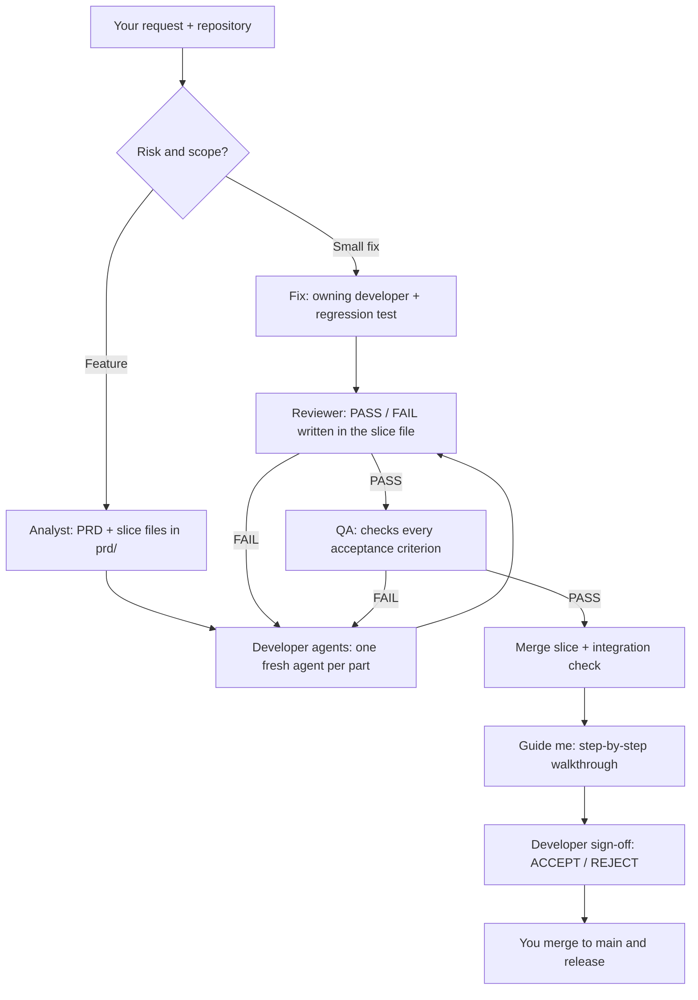

# Engineering Judgment Skill

**Ship AI-assisted code you can explain, verify, and stand behind.**

[](LICENSE)
[](https://agentskills.io/specification)

AI coding agents can write a feature in minutes. That does **not** mean the team understands its trade-offs, its failure modes, or what the green checks actually prove.

**Engineering Judgment** is one portable [Agent Skill](https://agentskills.io/specification) that adds *intent, risk-aware orchestration, verification evidence, and accountable handoff* to your existing coding workflow. It still lets your agent write the code. It just helps you know what you are shipping.

> **The gap:** more code generated than engineers can meaningfully review. The goal is **verified value per minute**, not the maximum number of generated lines.

## 30-second start

From your project directory, with Node.js and a supported coding-agent client installed:

```bash
npx skills add dimitriskl/Engineering-judgment-skill --skill engineering-judgment
```

Choose your coding agent when prompted. Then open a **new agent session** and ask:

```text
Use engineering-judgment in Auto mode.
Implement this change in my repo: [describe the change].
Use existing agents, PRDs, and tasks if available.
Show me what actually ran, what the checks prove, and what remains unverified.
```

The CLI and agent availability vary by environment. **Installation does not guarantee auto-activation**. Explicitly invoke `engineering-judgment` for consequential tasks.

## What it does

| Problem | What the skill adds |
| --- | --- |
| Requirements are vague | An analyst writes a PRD and slice files in `prd/`, asking you only what is unclear |
| Agents invent design choices | Makes important assumptions and decisions visible |
| Multiple agents drift apart | Each slice has a written Contract both backend and frontend build against |
| Tests pass but behavior is broken | Separates what was *tested* from what was *not tested* |
| Reviewer only reads a summary | Asks the reviewer to inspect the original diff, requirements, and output |
| Deadlines encourage rubber-stamping | Cuts ceremony and scope before critical verification |
| You ship code you never looked at | **Guide me** walks you through the changes step by step before your Developer sign-off |

**It does not require C#, Angular, subagents, or other vendors' skills.** Those are integrations, not dependencies. It works in **Claude Code and Codex CLI**.

## How it works



The skill reuses what your repo already has (existing PRDs, specs and issues are converted, not duplicated). A 10-minute fix does not need a PRD.

## Pick a mode

| Mode | When to use | Example |
| --- | --- | --- |
| **Auto** | Most development | `Use engineering-judgment in Auto mode to add pagination.` |
| **Full feature** | Ambiguous or cross-cutting work | `Use engineering-judgment in Full feature mode to design and implement invoice approval.` |
| **Fix + Deadline** | Production issue, limited time | `Use engineering-judgment in Fix + Deadline mode. I have 30 minutes; fix this retry bug.` |
| **Audit** | Existing PR/diff | `Use engineering-judgment in Audit mode on my branch. What do passing tests miss?` |
| **Guide me** | See what was built, step by step, and sign off | `Use engineering-judgment in Guide me mode on this branch.` |
| **Drill** | Improve your own engineering judgment (the only mode with quiz questions) | `Use engineering-judgment in Drill mode. Ask one question at a time about a real design decision.` |

### Who is working right now

The skill prints a line each time an agent starts or finishes, and says whether a separate agent really ran or the main agent did the work as a fallback:

```text
▶ Now working: analyst (data-analyst-expert) · PRD invoice-approval · dispatched
✓ Done: analyst (data-analyst-expert) · 5 stories, 2 open questions
▶ Now working: backend (csharp-expert-developer) · slice 001 · dispatched
✓ Done: backend (csharp-expert-developer) · 3 files, dotnet test PASS
▶ Now working: reviewer (main agent) · review · FALLBACK, not independent
```

### What the handoff looks like

```text
Delivered: Fixed duplicate webhook processing
Agents: backend specialist invoked; reviewer unavailable (self-review fallback)
Evidence: dotnet test ... — PASS (14 tests)
Proved: duplicate sequential deliveries create one order
NOT proved: two workers racing or ERP commit followed by timeout
Decision: enforce idempotency at the persistence boundary
Status: READY FOR HUMAN REVIEW (not approved for deployment)
```

Example output only, not a test result from your project.

## Human-on-the-loop: the files are the board

This workflow is **human-on-the-loop**: the orchestrator (your main agent session running the skill) drives the work, and you step in only where your judgment is needed. Agents never stop for routine approvals; they stop only when something is unclear. You answer in chat, and every question and answer is saved in the files.

```
your-project/
  prd/
    invoice-approval/
      invoice-approval.md          ← PRD: stories, invariants, decisions, Q&A, slice list, sign-off
      prd-tasks/
        001-approve-invoice.md     ← one vertical slice: Contract, backend/frontend parts,
        002-approval-history.md       acceptance criteria, review + QA notes, history
```

Each slice moves through a kanban, and every step runs in a **fresh agent** that works from the files alone:

`To do → In development → In review → In QA → Completed` (or `Blocked: needs clarification`)

- **Analyst** writes the PRD and slices (each fully implementable: exact files, contract, test commands).
- **Backend / frontend developers** build their part and mark it `Developed` with test evidence.
- **Reviewer** writes PASS or FAIL into the slice file; FAIL goes back to the developer with what must be done.
- **QA** checks every acceptance criterion and writes PASS or FAIL; FAIL goes back to the developer.
- After **3 failures** on one slice, the orchestrator stops and asks you.
- Independent slices can run **in parallel git worktrees**, only if you say yes.
- Work happens on `feature/<prd-name>`; nothing is merged to `main` or pushed for you.

At the end, **Guide me** shows a numbered list of the major changes in the order the code runs, one step at a time (`file:line`, what, why, proof). Type `next`, `back`, `go N`, `ask …`, `change …` (sent back to the developer) or `approve all`. Your decision is recorded as the **Developer sign-off** in the PRD: ACCEPT or REJECT, with your git name, date and commit. See the [example PRD folder](examples/prd/invoice-approval/).

You own: answers to open questions, escalations, consent to worktrees, the sign-off, and merge/push/release.

## Map your own agents

Map your agents to the five roles in an optional `.engineering-workflow.json` placed in the **root of your project repository** (the repo you work in, not this skill's folder). Copy [.engineering-workflow.json](.engineering-workflow.json) there and replace the names with your own:

```json
{
  "agents": {
    "analyst": { "name": "my-analyst-agent" },
    "backend": { "name": "my-backend-agent" },
    "frontend": { "name": "my-frontend-agent" },
    "qa": { "name": "my-qa-agent" },
    "reviewer": { "name": "my-code-reviewer" }
  }
}
```

The reviewer and QA write their verdicts into the slice file themselves, so they need permission to edit files. The orchestrator checks with `git diff` that they changed nothing else. If your reviewer can't edit files, the orchestrator records its verdict word for word, labelled with the agent's name.

Names above are examples. **A config file does not create subagents.** If delegation is unavailable, the main agent does that step itself and labels it `FALLBACK, not independent`. No third-party planning skills are needed.

## Manual installation (no Node required)

Copy the *entire* [`skills/engineering-judgment/`](skills/engineering-judgment/) directory into **one** of these locations in your target project:

| Client | Project-level destination |
| --- | --- |
| OpenAI Codex | `.agents/skills/engineering-judgment/` |
| Claude Code | `.claude/skills/engineering-judgment/` |
| GitHub Copilot in VS Code | `.github/skills/engineering-judgment/` |

Example (macOS/Linux):

```bash
git clone https://github.com/dimitriskl/Engineering-judgment-skill.git
mkdir -p YourProject/.agents/skills
cp -R Engineering-judgment-skill/skills/engineering-judgment YourProject/.agents/skills/
```

Example (PowerShell):

```powershell
git clone https://github.com/dimitriskl/Engineering-judgment-skill.git
New-Item -ItemType Directory -Force C:\src\YourProject\.claude\skills | Out-Null
Copy-Item -Recurse .\Engineering-judgment-skill\skills\engineering-judgment C:\src\YourProject\.claude\skills\
```

Use the corresponding destination for your agent. Restart its session, then invoke the skill explicitly. Your existing agent definitions and third-party skills are not replaced.

> **Migrating from the older "Engineering Judgment Coach":** back up/remove the old `engineering-judgment-coach` directory in your agent's skills folder to avoid duplicate or conflicting skill discovery. The new invocation name is `engineering-judgment`.

## Requirements, trust, and limitations

- A coding agent that supports [Agent Skills](https://agentskills.io/specification). No specific language/framework is required.
- This is an **instruction-based workflow**, not a runtime permission system, CI service, or autonomous background worker.
- It cannot guarantee agent delegation, test execution, or correctness; it must report unavailable capabilities honestly.
- It never treats a green test or an agent's self-review as sufficient proof of production safety.
- It should not silently push, merge, deploy, modify production data, or make irreversible decisions.
- Review third-party skills and repository instructions before enabling them, especially in untrusted repositories.

See [a real-world-style walkthrough](examples/live-session.md) and the [skill source](skills/engineering-judgment/SKILL.md).

## Contributing

Bug reports, false-positive reviews, missing risk checks, documentation fixes, and integrations for other stacks are welcome. Please read [CONTRIBUTING.md](CONTRIBUTING.md). Especially valuable: **reproducible examples where the skill made a bad engineering call**.

This project is independent and not affiliated with OpenAI, Anthropic, GitHub or Matt Pocock. The analyst playbook adapts ideas from Matt Pocock's planning skills (domain-glossary interviews, PRDs, vertical-slice issues).

## License

[MIT](LICENSE). Use it, modify it, share improvements.
