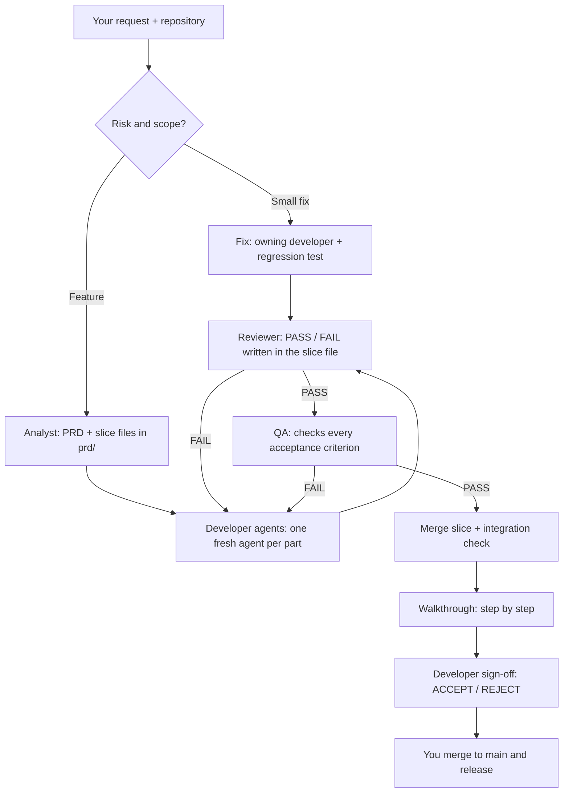

# Engineering Judgment Skill

Walkthroughs begin with a plain-language explanation of the approach and a code map showing the files, classes and methods involved. Interfaces that support diagrams can also show a visual flow.

For a PR or Ship handoff, the workflow summarizes merge risk across verification, alignment, impact, rollback and error detection. QA can attach concise evidence of meaningful UI flows, and teams can optionally learn from review misses and false positives. Existing L0–L2 routing and human sign-off remain in place.

**Ship AI-assisted code you can explain, verify, and stand behind.**

[](LICENSE)
[](https://agentskills.io/specification)

AI coding agents can write a feature in minutes. That does **not** mean the team understands its trade-offs, its failure modes, or what the green checks actually prove.

**Engineering Judgment** is one portable [Agent Skill](https://agentskills.io/specification) that adds *intent, risk-aware orchestration, verification evidence, and accountable handoff* to your existing coding workflow. It still lets your agent write the code. It just helps you know what you are shipping.

> **The gap:** more code generated than engineers can meaningfully review. The goal is **verified value per minute**, not the maximum number of generated lines.

## 30-second start

**One command installs the skill and all the [agents](#agents-use-mine-or-map-your-own)** for Claude Code and Codex. Run it from your project directory (Node.js 22.20 or later required):

```powershell
# Windows (PowerShell)
irm https://raw.githubusercontent.com/dimitriskl/engineering-judgment-skill/main/install/install.ps1 | iex
```

```bash
# Linux and macOS
curl -fsSL https://raw.githubusercontent.com/dimitriskl/engineering-judgment-skill/main/install/install.sh | bash
```

- **First run** asks once: **personal** (all your projects: `~/.claude`, `~/.codex`) or **project** (only the current folder).
- **Later runs** reuse that answer and **update** whatever is already installed. Changed agent files are replaced, and your old copy is kept as `<file>.bak`. To change the answer, run with `--scope personal|project` (bash: `… | bash -s -- --scope project`) or set `$env:EJ_SCOPE` (PowerShell).
- It also sets **auto-compact at 40%** (below) if you haven't set it yourself, and in project scope adds `.engineering-workflow.json` if the project has none.
- The agent list lives in [`install/agents.txt`](install/agents.txt).

Only want the skill? `npx skills add dimitriskl/engineering-judgment-skill --skill engineering-judgment`, then choose your coding agent when prompted.

Then open a **new agent session**. Example: add **two-factor authentication (2FA) to login** and walk through the result in the Walkthrough before you sign off.

**Once: set auto-compact to 40%.** Models get less reliable once their context is more than about 40% full. Every agent that is still working on its job compacts automatically at 40% and carries on; the next job always starts in a fresh agent. This is a host setting; the installer above sets it for you, or set it by hand:

```powershell
# Claude Code (main session and subagents). Windows PowerShell; on macOS/Linux: export CLAUDE_AUTOCOMPACT_PCT_OVERRIDE=40
setx CLAUDE_AUTOCOMPACT_PCT_OVERRIDE 40
```

```toml
# Codex CLI: ~/.codex/config.toml (or .codex/config.toml in the project). 40% of the model's context window, e.g. 400,000 tokens → 160000
model_auto_compact_token_limit = 160000
```

**1. Start the feature:**

```text
Use engineering-judgment in Full feature mode.
Add two-factor authentication (2FA) to login: after the password, the user enters a 6-digit code from an authenticator app.
Ask me only what is unclear, then finish with the Walkthrough so I can walk through the changes and sign off.
```

**2. Answer the questions**, one at a time (`🟣 analyst [opus, high] (requirements-analyst) · Question 1/4: …`). Reply with your answer, or accept the recommended one:

```text
yes, use the recommended answer
```

**3. Allow parallel work** if the skill asks (independent slices in separate worktrees), or keep it serial:

```text
yes, run 002 and 003 in parallel
```

**4. Walk through the changes in the Walkthrough**, one step at a time (see [what happens in this step](#what-happens-in-the-walkthrough-step) below):

```text
next
back
go 4
ask why is the code checked before the session is created?
change lock the account for 15 minutes after 5 wrong codes
approve all
```

**5. Sign off:**

```text
ACCEPT
```

### What happens in the Walkthrough step

When every slice is `Completed`, the orchestrator stops building and shows you what was built, **in the order the code runs** (like stepping through it with a debugger), not file by file. Nothing changes in your code during the walk; it only reads the diff since the feature branch started.

```
━━ Walkthrough · login-2fa · 7 steps ━━━━━━━━━━━━━━━━━━━━━━━━━━━━━━━━
   1. ✓ POST /auth/login: password ok → "2FA required"   (slice 002)
 ▶ 2.   Verify the 6-digit code                          (slice 002)
   3.   Lock after 5 wrong codes                         (slice 002)
   4.   Issue the session only after 2FA                 (slice 002)
   5.   2FA setup: secret + QR code                      (slice 001)
   6.   Code entry screen: loading / error states        (slice 003)
   7.   Recovery codes                                   (slice 004)
──────────────────────────────────────────────────────────────────
Step 2/7 · src/Auth/TwoFactorService.cs:40-58
  What:  Checks the code against the user's secret, allowing ±30 s clock drift.
  Why:   Acceptance criterion 002-1; a wrong or expired code returns 401.
  Tests: 3 for this step
    ✓ tests/Auth/TwoFactorServiceTests.cs:18 · VerifyCode_Valid_ReturnsTrue
        a correct code within 30 s is accepted · PASS · new
    ✓ tests/Auth/TwoFactorServiceTests.cs:35 · VerifyCode_Expired_Returns401
        a code older than the drift window is rejected · PASS · new
    ✓ tests/Auth/TwoFactorServiceTests.cs:51 · VerifyCode_WrongCode_Returns401
        a wrong code is rejected and counted as a failed attempt · PASS · new
──────────────────────────────────────────────────────────────────
 next · back · go 7 · open 2 · tests · ask … · change … · approve all
```

- **Each card** shows where the code is (`file:line`), **what** it does, **why** (the slice and acceptance criterion) and the **tests** written for that step: file and line, test name, what it checks in plain words, its result (PASS / FAIL / NOT RUN) and whether it is new, changed or existing. A step with no test shows `none written — not verified`.
- **`next` / `back` / `go N`** move through the list; viewed steps get `✓`. **`tests`** shows the code of those tests (arrange, act, assert). **`ask …`** answers from the code and evidence and stays on the step.
- **Your editor follows along.** When the session runs inside VS Code (terminal or AI pane), each card opens its file at the step's line in your editor (`code -r -g <file>:<line>`; `cursor` for Cursor). **`open 2`** jumps to the card's second location (its first test), and **`editor off`** / **`editor on`** turn this off and back on. Every `file:line` is also Ctrl+clickable in VS Code's terminal. In the AI panes, clicks don't always work yet, which is why the jump exists. Outside VS Code, or if the `code` command is missing, you get the text links only.
- **`change …`** is saved in that slice file as an `open` change request and the step gets `✎`. You keep walking. At the end, those slices go back to the developer, then review and QA again, and the next Walkthrough shows **only the changed steps**.
- **`approve all`** skips the rest; the sign-off honestly records which steps you didn't view.
- **At the end** you see a one-screen summary: steps viewed, change requests, and **blind spots** (what the tests did not prove). Then you choose **ACCEPT** or **REJECT**. ACCEPT is only possible when every slice is Completed and no change request is still open. Your decision is written into the PRD's `Developer sign-off` with your git name, the date and the commit, then the orchestrator offers the merge; you do it.

If you stop halfway, open a new session and continue from the files: `Use engineering-judgment in Auto mode. Resume the board in prd/ and continue with the next ready slice.` To walk through the changes again later: `Use engineering-judgment in Walkthrough mode on prd/login-2fa.`

**What each agent does in this example:**

- ⚪ **orchestrator** (your main session): creates `feature/login-2fa`, runs the board, asks you the questions, and records your sign-off.
- 🟣 **analyst**: reads the login code and writes `prd/login-2fa/` with the PRD and slices (e.g. 2FA setup, code check at login, recovery codes), each with its contract and tests.
- 🔵 **backend**: builds each slice's API part (secret storage, code verification, attempt limits) and records its test evidence.
- 🟢 **frontend**: builds each slice's screens (QR-code setup, code entry, error states) against the same contract.
- 🟠 **reviewer**: reviews each slice for bugs and security gaps (secret handling, brute force, bypasses); FAIL sends it back to the developer.
- 🟡 **qa**: checks every acceptance criterion (wrong code, expired code, lockout); PASS marks the slice Completed.

The CLI and agent availability vary by environment. **Installation does not guarantee auto-activation**. Explicitly invoke `engineering-judgment` for consequential tasks.

## What it does

| Problem | What the skill adds |
| --- | --- |
| Requirements are vague | An analyst writes a PRD and slice files in `prd/`, asking you only what is unclear |
| Agents invent design choices | Makes important assumptions and decisions visible |
| Multiple agents drift apart | Each slice has a written Contract both backend and frontend build against |
| Tests pass but behavior is broken | Separates what was *tested* from what was *not tested* |
| Reviewer only reads a summary | Asks the reviewer to inspect the original diff, requirements, and output |
| Deadlines encourage rubber-stamping | Cuts ceremony and scope before critical verification |
| You ship code you never looked at | The **Walkthrough** takes you through the changes step by step before your Developer sign-off |

**It does not require C#, Angular, subagents, or other vendors' skills.** Those are integrations, not dependencies. It works in **Claude Code and Codex CLI**.

## How it works



The skill reuses what your repo already has (existing PRDs, specs and issues are converted, not duplicated). A 10-minute fix does not need a PRD.

## Pick a mode

| Mode | When to use | Example |
| --- | --- | --- |
| **Auto** | Most development | `Use engineering-judgment in Auto mode to add pagination.` |
| **Full feature** | Ambiguous or cross-cutting work | `Use engineering-judgment in Full feature mode to design and implement invoice approval.` |
| **Fix + Deadline** | Production issue, limited time | `Use engineering-judgment in Fix + Deadline mode. I have 30 minutes; fix this retry bug.` |
| **Audit** | Existing PR/diff | `Use engineering-judgment in Audit mode on my branch. What do passing tests miss?` |
| **Walkthrough** (formerly Guide me) | See what was built, step by step, and sign off | `Use engineering-judgment in Walkthrough mode on this branch.` |
| **Drill** | Improve your own engineering judgment (the only mode with quiz questions) | `Use engineering-judgment in Drill mode. Ask one question at a time about a real design decision.` |

### Who is working right now

The skill prints a line each time an agent starts or finishes, and says whether a separate agent really ran or the main agent did the work as a fallback. Every message also starts with **who is speaking**, and each role has its own color marker, so you never have to guess which agent wrote a paragraph. The brackets show the model and effort that run actually used, for example `🟣 analyst [opus, high] (requirements-analyst):`:

| Marker | Role |
| --- | --- |
| 🟣 analyst | writes the PRD and slices |
| 🔵 backend | builds the backend part |
| 🟢 frontend | builds the frontend part |
| 🟠 reviewer | reviews each slice |
| 🟡 qa | checks the acceptance criteria |
| ⚪ orchestrator | the main session: routing, integration, your sign-off |

```text
🟣 ▶ Now working: analyst [opus, high] (requirements-analyst) · PRD invoice-approval · subagent `analyst_prd` started
🟣 ✓ Done: analyst [opus, high] (requirements-analyst) · 5 stories, 2 open questions
🟣 analyst [opus, high] (requirements-analyst): The plan adds one shared protection key, so all API instances can read the stored secrets.
🟣 analyst [opus, high] (requirements-analyst) · Question 1/2: Should the key survive a restart? Recommended: yes, stored outside the app folder.
🔵 ▶ Now working: backend [sonnet, medium] (csharp-expert-developer) · slice 001 · subagent `backend_s001` started
🔵 ✓ Done: backend [sonnet, medium] (csharp-expert-developer) · 3 files, dotnet test PASS
🟠 ▶ Now working: reviewer [session] (main agent) · review · FALLBACK, not independent
⚪ orchestrator [sonnet, medium]: Slice 001 is in review; nothing needs your input yet.
```

The markers are plain emoji, so they show the same in Claude Code and Codex CLI. Each subagent run gets a readable name (`<role>_<slice>`). When Codex prints its own line, such as "Interacted with `/root/backend_s001`", the line just before it (`🔵 ▶ Now working: backend [sonnet, medium] (csharp-expert-developer) · slice 001 · subagent `backend_s001` started`) tells you which agent that is. Lines the host tool prints itself (such as "Waiting for agents") come from the tool, not the skill, and have no marker.

### What the handoff looks like

```text
Delivered: Fixed duplicate webhook processing
Agents: backend specialist invoked; reviewer unavailable (self-review fallback)
Evidence: dotnet test ... — PASS (14 tests)
Proved: duplicate sequential deliveries create one order
NOT proved: two workers racing or ERP commit followed by timeout
Decision: enforce idempotency at the persistence boundary
Status: READY FOR HUMAN REVIEW (not approved for deployment)
```

Example output only, not a test result from your project.

## Human-on-the-loop: the files are the board

This workflow is **human-on-the-loop**: the orchestrator (your main agent session running the skill) drives the work, and you step in only where your judgment is needed. Agents never stop for routine approvals; they stop only when something is unclear. You answer in chat, and every question and answer is saved in the files.

```
your-project/
  prd/
    invoice-approval/
      invoice-approval.md          ← PRD: stories, invariants, decisions, Q&A, slice list, sign-off
      prd-tasks/
        001-approve-invoice.md     ← one vertical slice: Contract, backend/frontend parts,
        002-approval-history.md       acceptance criteria, review + QA notes, history
```

Each slice moves through a kanban, and every step runs in a **fresh agent** that works from the files alone:

`To do → In development → In review → In QA → Completed` (or `Blocked: needs clarification`)

- **Analyst** writes the PRD and slices (each fully implementable: exact files, contract, test commands).
- **Backend / frontend developers** build only their own part against the slice's written Contract, fill in its `Evidence:` block (`command | exit code | output`) and mark it `Developed`. Within one working tree the parts run one after another.
- **Reviewer** writes PASS or FAIL into the slice file; FAIL goes back to the developer with what must be done.
- **QA** checks every acceptance criterion and writes PASS or FAIL; FAIL goes back to the developer.
- After **3 failures** on one slice (review, QA or the post-merge check), the orchestrator stops and asks you. A blocked slice records `Blocked from:` so it can resume exactly where it stopped.
- Independent slices can run **in parallel git worktrees**, only if you say yes.
- Work happens on `feature/<prd-name>`, created before the analyst runs; the starting point is recorded as `Base:` in the PRD. Nothing is merged to `main` or pushed for you.
- **Your own work is safe.** If you have uncommitted changes, the orchestrator asks you to stash, commit or stop before any agent runs. Before every agent run it records a snapshot (HEAD + `git status`); afterwards it checks that the agent only touched what its role allows, reverts anything else from that run only, and allows one corrective re-run before asking you.
- **Resume any time.** A new session rebuilds the board from the files and `git worktree list`; nothing depends on chat history.

At the end, the **Walkthrough** shows a numbered list of the major changes in the order the code runs, one step at a time (`file:line`, what, why, proof). Type `next`, `back`, `go N`, `ask …`, `change …` (saved as an `open` change request and sent back to the developer) or `approve all`. ACCEPT is only possible when every slice is Completed and no change request is still open. Your decision is recorded as the **Developer sign-off** in the PRD: ACCEPT or REJECT, with your git name, date and commit. See the [example PRD folder](examples/prd/invoice-approval/).

You own: answers to open questions, escalations, consent to worktrees, the sign-off, and merge/push/release.

## Agents: use mine or map your own

The skill works with any agents. These are the ones it was built and tested with — each is a free, MIT-licensed repository with a Claude Code (`.md`) and a Codex (`.toml`) version:

| Role | Agent | What it does in the workflow | Download |
| --- | --- | --- | --- |
| `analyst` | requirements-analyst | Explores the code, asks only what changes the build, writes the PRD and slices; read-only data checks | [repo](https://github.com/dimitriskl/requirements-analyst) |
| `backend` | csharp-expert-developer | Builds the backend part of each slice (.NET) | [repo](https://github.com/dimitriskl/csharp-expert-developer) |
| `frontend` | angular-typescript-developer | Builds the frontend part of each slice (Angular) | [repo](https://github.com/dimitriskl/angular-typescript-developer) |
| `qa` | qa-automation-engineer | Checks every acceptance criterion, read-only; writes its own verdict | [repo](https://github.com/dimitriskl/qa-automation-engineer) |
| `reviewer` | senior-code-reviewer (v1.1.0+) | Reviews each slice, read-only except its own verdict | [repo](https://github.com/dimitriskl/senior-code-reviewer) |

Also available: [ui-ux-developer](https://github.com/dimitriskl/ui-ux-developer) (an alternative `frontend` focused on UX and accessibility), [software-architect](https://github.com/dimitriskl/software-architect) (for design questions outside the board) and [data-analyst-bi-expert](https://github.com/dimitriskl/data-analyst-bi-expert) (an alternative `analyst` for data-heavy and BI work).

Each repository's README shows how to install the agent for one project (`.claude/agents/`, `.codex/agents/`) or for all your projects (`~/.claude/agents/`, `~/.codex/agents/`).

**Connect them to the skill** with `.engineering-workflow.json` in the **root of your project repository** (the repo you work in, not this skill's folder). The [default file](.engineering-workflow.json) already maps the agents above — copy it as it is:

```json
{
  "agents": {
    "analyst": {
      "name": "requirements-analyst",
      "model": { "claude": "opus", "codex": "gpt-6.1-sol" },
      "effort": { "claude": "high", "codex": "high" }
    },
    "backend": {
      "name": "csharp-expert-developer",
      "model": { "claude": "sonnet", "codex": "gpt-6.1-terra" },
      "effort": { "claude": "medium", "codex": "medium" }
    },
    "frontend": {
      "name": "angular-typescript-developer",
      "model": { "claude": "sonnet", "codex": "gpt-6.1-terra" },
      "effort": { "claude": "medium", "codex": "medium" }
    },
    "qa": {
      "name": "qa-automation-engineer",
      "model": { "claude": "sonnet", "codex": "gpt-6.1-terra" },
      "effort": { "claude": "low", "codex": "low" }
    },
    "reviewer": {
      "name": "senior-code-reviewer",
      "model": { "claude": "opus", "codex": "gpt-6.1-sol" },
      "effort": { "claude": "high", "codex": "high" }
    }
  }
}
```

**Model and effort per role.** Each role can set `model` and `effort`, with one value for Claude Code (`claude`) and one for Codex (`codex`). The orchestrator detects which tool it runs in and uses only that tool's values. The defaults spend the strong model where mistakes cost most and save your limits elsewhere:

| Role | Claude Code | Codex | Why |
| --- | --- | --- | --- |
| `analyst` | opus · high | gpt-6.1-sol · high | Wrong requirements make every later step wrong |
| `reviewer` | opus · high | gpt-6.1-sol · high | The last independent check before QA and your sign-off |
| `backend`, `frontend` | sonnet · medium | gpt-6.1-terra · medium | Builds from a complete contract, owned files and test commands |
| `qa` | sonnet · low | gpt-6.1-terra · low | Runs the listed checks against written acceptance criteria |

- **Change one run** without editing the file: start your prompt with a line such as `reviewer: opus high`.
- **Leave a value out** (or empty) and that agent uses your session's model or effort. If the Codex or Claude `model` is empty, the orchestrator asks you once which models to use (pick them from `/model`), writes them into the file and shows you the change.
- **Model names change.** If a name is rejected, the agent runs on your session's model and the status line says so. Check `/model` in your tool for the current names.
- **Settings that win over the file:** in Claude Code, the `CLAUDE_CODE_EFFORT_LEVEL` and `CLAUDE_CODE_SUBAGENT_MODEL_FORCE` environment variables; in Codex, a `model` line inside an agent's own `.toml` file (the agents above have none). The orchestrator warns you if one is set.
- The orchestrator itself is your main session, so its model is the one you choose when you start (`/model`). It only reads the board, so a mid-level model is usually enough.

**Using other agents?** Replace each `name` with your own agent's name. The roles are `analyst`, `backend`, `frontend`, `qa` and `reviewer`; for each, only `name`, `model` and `effort` are read. Leave a role out if you have no agent for it.

The reviewer and QA write their verdicts into the slice file themselves, so they need permission to edit files (in Codex, a `workspace-write` sandbox). The orchestrator checks that they changed nothing else. If a reviewer can't edit files, the orchestrator records its verdict word for word, labelled with the agent's name.

**A config file does not create subagents.** If an agent isn't installed or can't be invoked, the main agent does that step itself and labels it `FALLBACK, not independent`. No third-party planning skills are needed.

## Manual installation (no Node required)

Copy the *entire* [`skills/engineering-judgment/`](skills/engineering-judgment/) directory into **one** of these locations in your target project:

| Client | Project-level destination |
| --- | --- |
| OpenAI Codex | `.agents/skills/engineering-judgment/` |
| Claude Code | `.claude/skills/engineering-judgment/` |
| GitHub Copilot in VS Code | `.github/skills/engineering-judgment/` |

Example (macOS/Linux):

```bash
git clone https://github.com/dimitriskl/engineering-judgment-skill.git
mkdir -p YourProject/.agents/skills
cp -R engineering-judgment-skill/skills/engineering-judgment YourProject/.agents/skills/
```

Example (PowerShell):

```powershell
git clone https://github.com/dimitriskl/engineering-judgment-skill.git
New-Item -ItemType Directory -Force C:\src\YourProject\.claude\skills | Out-Null
Copy-Item -Recurse .\engineering-judgment-skill\skills\engineering-judgment C:\src\YourProject\.claude\skills\
```

Use the corresponding destination for your agent. Restart its session, then invoke the skill explicitly. Your existing agent definitions and third-party skills are not replaced.

> **Migrating from the older "Engineering Judgment Coach":** back up/remove the old `engineering-judgment-coach` directory in your agent's skills folder to avoid duplicate or conflicting skill discovery. The new invocation name is `engineering-judgment`.

## Updating the skill

Check [CHANGELOG.md](CHANGELOG.md) first. A new major version (for example 2.x → 3.0.0) can change how the skill works or what `.engineering-workflow.json` contains.

**Update the skill and all agents together** (Node.js 22.20 or later):

```powershell
irm https://raw.githubusercontent.com/dimitriskl/engineering-judgment-skill/main/install/update.ps1 | iex
```

```bash
curl -fsSL https://raw.githubusercontent.com/dimitriskl/engineering-judgment-skill/main/install/update.sh | bash
```

The updater runs the installer again and reuses the saved personal or project scope. For a project install, run it from that project directory. To select a scope, set `$env:EJ_SCOPE = 'personal'` or `'project'` in PowerShell, or use `... | bash -s -- --scope project` in bash. Changed agent files are backed up as `<file>.bak`; existing workflow configuration and auto-compact values are kept. Missing skill or agent files are installed. The installer may add missing configuration and auto-compact settings as described in the 30-second start.

**Installed with `npx skills`** (Node.js 22.20 or later):

```bash
npx skills check                          # shows whether an update is available
npx skills update engineering-judgment    # updates a project install (run it in your project folder)
npx skills update -g                      # updates global installs (e.g. ~/.agents/skills)
```

Run in a project folder, `update` may update only that project's skills. If you installed the skill globally (with `-g`), use `npx skills update -g`. A session that is already running keeps the old instructions, so start a new one after updating.

**Installed manually.** Get the latest version, then replace the whole skill folder. Delete the old folder first, so files removed in the new version don't stay behind.

macOS / Linux:

```bash
cd engineering-judgment-skill && git pull && cd ..
rm -rf YourProject/.agents/skills/engineering-judgment
cp -R engineering-judgment-skill/skills/engineering-judgment YourProject/.agents/skills/
```

PowerShell:

```powershell
git -C .\engineering-judgment-skill pull
Remove-Item -Recurse -Force C:\src\YourProject\.claude\skills\engineering-judgment
Copy-Item -Recurse .\engineering-judgment-skill\skills\engineering-judgment C:\src\YourProject\.claude\skills\
```

Use the same skills folder you installed to (`.agents/skills/`, `.claude/skills/` or `.github/skills/`).

**After updating:**

- Start a new agent session, so the new version is loaded.
- Compare your project's `.engineering-workflow.json` with the [current default](.engineering-workflow.json) and remove keys the skill no longer reads.
- Your `prd/` folders are not touched by an update. A new session resumes the board from them.
- If you update only the skill with `npx skills` or manually, update the agents separately or use the combined updater above.

## Requirements, trust, and limitations

- A coding agent that supports [Agent Skills](https://agentskills.io/specification). No specific language/framework is required.
- This is an **instruction-based workflow**, not a runtime permission system, CI service, or autonomous background worker.
- It cannot guarantee agent delegation, test execution, or correctness; it must report unavailable capabilities honestly.
- It never treats a green test or an agent's self-review as sufficient proof of production safety.
- It should not silently push, merge, deploy, modify production data, or make irreversible decisions.
- Review third-party skills and repository instructions before enabling them, especially in untrusted repositories.

See [a real-world-style walkthrough](examples/live-session.md) and the [skill source](skills/engineering-judgment/SKILL.md).

## Contributing

Bug reports, false-positive reviews, missing risk checks, documentation fixes, and integrations for other stacks are welcome. Please read [CONTRIBUTING.md](CONTRIBUTING.md). Especially valuable: **reproducible examples where the skill made a bad engineering call**.

This project is independent and not affiliated with OpenAI, Anthropic, GitHub or Matt Pocock. The analyst playbook adapts ideas from Matt Pocock's planning skills (domain-glossary interviews, PRDs, vertical-slice issues).

## License

[MIT](LICENSE). Use it, modify it, share improvements.
